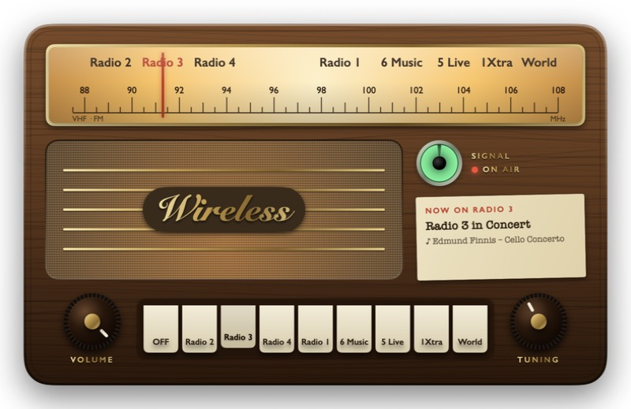
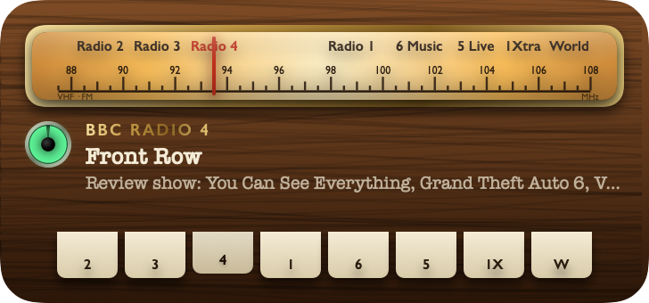

# Wireless

A 1950s valve radio for your Mac that plays live BBC radio. It lives on your desktop as a widget.

[](https://github.com/josephgoksu/wireless/releases/latest/download/Wireless.dmg)

macOS 15+ · Apple silicon and Intel · signed and notarized. Open the DMG, drag Wireless to Applications, and launch it.



It is drawn entirely in SwiftUI, with no image assets and no dependencies. The app is about 850 lines of Swift.

| Part | What it does |
|---|---|
| Piano keys | Press one and the needle sweeps there, hissing past other stations as it goes. The key latches down. |
| Tuning knob | Drag it, scroll, or use ← →. Between stations you hear real static, crackle, and the heterodyne whistle. The whistle falls to zero beat as you land on a station. |
| Valves | The dial and grille glow warm up with a flicker, and sound fades in with them. There is a faint 50 Hz mains hum. |
| Magic eye | The green wedge closes as the signal locks on. |
| Programme card | Typed from the BBC schedule: what's on now and, on music stations, the track playing. |
| Widget | Small or medium. The medium one has a row of preset keys; any click tunes the set in. |
| Media keys | Play/pause powers the set; next and previous move between stations. Shows in Control Center. |

Keys: `1`–`8` presets · `←` `→` tune · `↑` `↓` volume · `space` power.



## Build

```bash
brew install xcodegen
make        # builds, installs to ~/Applications, launches
```

Widgets need a signed build. The Makefile takes the team from your Apple Development certificate. Override it with `DEVELOPMENT_TEAM=XXXXXXXXXX make`.

Add the widget from the desktop: right-click, Edit Widgets, search for Wireless.

To release, run `NOTARY_PROFILE=<keychain profile> PUBLISH=1 make release`. It builds a universal binary signed with Developer ID, notarizes and staples the DMG, and attaches it to a GitHub release for the version in `project.yml`.

## How it gets the audio

The BBC publishes no public API. Wireless uses the same endpoints as bbc.co.uk/sounds:

- **Audio:** `a.files.bbci.co.uk/ms6/live/.../hls/uk/pc_hd_abr_v2/aks/<station>.m3u8`, a stable master playlist that redirects to whichever CDN pool is current. It plays 320 kbps AAC in the UK. Abroad, Wireless falls back to the 96 kbps international stream.
- **What's on:** `rms.api.bbc.co.uk/v2/broadcasts/latest` and `/services/<id>/segments/latest`.

Live radio only, for personal listening. Not affiliated with the BBC.
